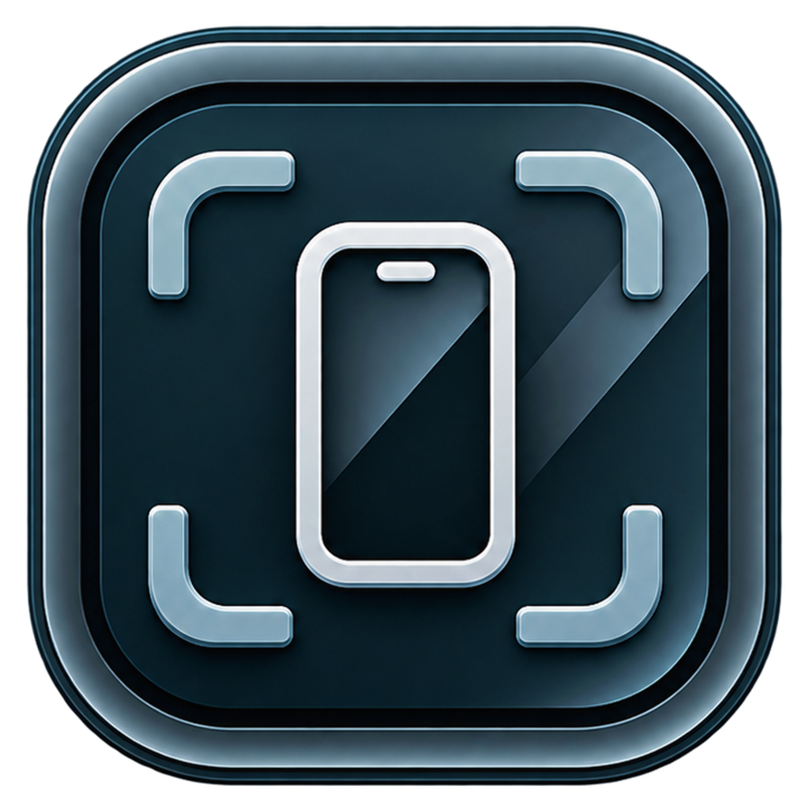

<p align="center">
  
</p>

<h1 align="center">PhoneFrame</h1>

<p align="center">
  <strong>A floating, phone-shaped window for your Android device.</strong><br/>
  <sub>Mirror and control real hardware in a transparent, always-on-top overlay — no emulator, no generic mirroring chrome, no separate scrcpy window.</sub>
</p>

<p align="center">
  
  
  
  
  
  
  
</p>

---

## Table of Contents

- [Why PhoneFrame](#why-phoneframe)
- [Features](#features)
- [Architecture](#architecture)
- [How Mirroring Works](#how-mirroring-works)
- [Getting Started](#getting-started)
- [FAQ](#faq)
- [Feedback](#feedback)
- [License](#license)

## Why PhoneFrame

An emulator gives you virtual hardware and a heavy IDE-shaped window. A desktop mirroring tool gives you the real device, but as another rectangle competing for screen space. PhoneFrame takes the opposite approach: the device you are already testing on, wrapped in the phone you are actually designing for, floating above your workspace.

| | Android emulator | scrcpy desktop window | **PhoneFrame** |
|---|---|---|---|
| Runs on | Virtual hardware | Real hardware | **Real hardware** |
| Window | Emulator chrome | Separate app window | **Transparent floating frame** |
| Frame | Generic device skin | Raw display | **Parametric chassis with bezel, notch, and buttons** |
| Input | Emulated | Backed by keyboard shortcuts | **Touch, scroll, and keyboard injected directly** |
| Audio | Emulator output | Device audio to PC | **Device audio to PC with exclusive routing** |
| Setup | SDK plus a virtual device | scrcpy and adb | **Bundled scrcpy server and bundled adb (Windows)** |

## Features

### Mirroring
- **WebCodecs H.264 pipeline** — the bundled scrcpy server streams over ADB sockets; frames are decoded with the hardware-accelerated `VideoDecoder` API and drawn straight to a GPU-backed canvas
- **Low-latency input** — pointer, drag, scroll, and keyboard events travel back through the scrcpy control channel without restarting the stream
- **Rotation aware** — the frame follows the device's real orientation and settles its aspect ratio only after the encoder's size reports stabilize
- **Audio with exclusive routing** — phone audio plays on the PC, the phone, or neither; the HUD volume rail drives both sides from one control
- **Automatic device tracking** — `adb track-devices` keeps the UI in sync with plug, unplug, authorization, and offline events

### The frame
- **Parametric SVG chassis** — bezel width, outer and screen radii, punch-hole or notch styles, speaker grille, and hardware buttons are all rendered from live geometry
- **Frame studio** — preset finishes plus a custom color wheel, with the side key and buttons recolored to match
- **Drag mode** — a deliberate hold moves the frame without stealing taps meant for the device
- **Immersive landscape fullscreen** — the mirrored display covers the whole monitor, taskbar included, while portrait stays windowed by design
- **Contextual HUD** — a slide-out drawer and a collapsed hardware side key keep controls reachable without permanent chrome

### Distribution
- **Bundled backend** — `scrcpy-server-v3.1.jar` and Google's Windows platform-tools ship with the project, so there is no separate scrcpy or Android SDK install on Windows
- **Self-contained installer** — the NSIS setup bundles the Electron app, server jar, icon, and adb into a per-user install with desktop and Start Menu shortcuts

## Architecture

```
PhoneFrame/
├── assets/                       # Embedded binaries, icons & server JARs
│   ├── platform-tools/           # Bundled Windows adb + USB driver DLLs
│   ├── phoneframe-icon.png       # App icon source render
│   ├── phoneframe-icon.ico       # Window / shortcut / installer icon
│   ├── scrcpy-server-v3.1.jar    # Official scrcpy server v3.1 JAR
│   └── scrcpy-server.jar         # Fallback server JAR
├── scripts/                      # Developer utility & diagnostic scripts
│   └── test_stream_diagnostics.ps1 # Standalone PowerShell stream test
├── src/
│   ├── main/                     # Electron Main Process (Node.js)
│   │   ├── assets.ts             # Dev/packaged asset path resolution
│   │   ├── adb/                  # ADB device tracking & discovery
│   │   │   ├── AdbTracker.ts     # Process wrapper for `adb track-devices`
│   │   │   └── index.ts
│   │   ├── mirror/               # Scrcpy server lifecycle & socket parser
│   │   │   ├── ScrcpyServerManager.ts # H.264 stream demuxer & IPC emitter
│   │   │   └── index.ts
│   │   └── index.ts              # Electron window lifecycle & IPC handlers
│   ├── preload/                  # Secure Context Isolation Bridge
│   │   └── index.ts              # Typed `window.electronAPI` bridge
│   └── renderer/                 # Frontend React Application (Vite)
│       ├── components/           # UI Components
│       │   ├── HUD/              # Floating overlay controls & audio rail
│       │   ├── icons/            # Zero-slop SVG icons
│       │   ├── PhoneFrame/       # SVG frame renderer & styling options
│       │   ├── SetupWizard/      # Step-by-step connection guide
│       │   ├── VideoCanvas/      # WebCodecs VideoDecoder & canvas renderer
│       │   └── index.ts          # Unified components barrel export
│       ├── styles/               # CSS Design Tokens & Reset
│       │   ├── tokens.css        # Palette & typography tokens
│       │   └── global.css
│       ├── types/                # Ambient TypeScript definitions
│       │   ├── assets.d.ts       # Static asset module declarations
│       │   └── electron.d.ts     # Preload API interface definitions
│       ├── App.tsx               # Primary application state orchestrator
│       └── main.tsx              # React DOM entry point
├── THIRD_PARTY_LICENSES/         # Open-source third-party licenses
├── index.html                    # Vite HTML entry
├── package.json                  # Dependencies, scripts & packaging config
├── tsconfig.json                 # TypeScript config (Renderer)
├── tsconfig.node.json            # TypeScript config (Main & Preload)
└── vite.config.ts                # Vite bundler configuration
```

## How Mirroring Works

1. **Detection:** `AdbTracker` watches connected devices through `adb track-devices`, with a polling fallback that catches anything the event stream misses.
2. **Push and forward:** `ScrcpyServerManager` pushes `scrcpy-server-v3.1.jar` to `/data/local/tmp/scrcpy-server.jar` and forwards a local TCP port to the server's abstract socket.
3. **Server launch:** the jar is started on the device with Android's `app_process`, tunnel-forwarding enabled, and the selected video and audio parameters.
4. **Demuxing:** the main process parses the scrcpy header, then splits the socket byte stream into codec configuration and H.264 NAL units, preserving 64-bit presentation timestamps.
5. **Decoding:** frames cross the IPC bridge to the renderer, where `VideoDecoder` configures itself from the stream's SPS profile and paints directly to an HTML5 canvas.

## Getting Started

### Prerequisites

| Component | Requirement |
|---|---|
| OS | Windows 10 or 11 (x64) for installed builds |
| Node.js | 18.0 or later, with npm (source builds) |
| ADB | Bundled on Windows; macOS/Linux source runs use `PATH` or a standard Android SDK location. `ADB_PATH` overrides both |
| Device | A physical Android device with Developer Options and USB debugging enabled |

### From source

```bash
git clone https://github.com/NomanRafique01/PhoneFrame-.git
cd PhoneFrame-
npm install

# Build main, preload, and renderer, then launch
npm run start:build
```

### Build commands

```bash
npm run build        # Compile main/preload and bundle the renderer
npm start            # Launch the built app without rebuilding
npm run pack         # Unpacked Windows build in release/win-unpacked
npm run installer    # NSIS installer in release/
```

`npm run installer` produces `release/PhoneFrame-Setup-<version>.exe`. The packaged app resolves its runtime assets from `resources/assets`, so scrcpy, adb, and the app icon work regardless of where the shortcut is launched from.

## FAQ

<details>
<summary><b>Do I need scrcpy installed?</b></summary>
No. PhoneFrame bundles <code>scrcpy-server-v3.1.jar</code>, pushes it to the device over ADB, and speaks its protocol directly. A desktop scrcpy installation is never used.
</details>

<details>
<summary><b>Do I need to install adb?</b></summary>
Not on Windows — the installed build ships Google's platform-tools and prefers that binary. Source runs on macOS or Linux fall back to <code>adb</code> on your <code>PATH</code> or in a standard Android SDK directory. Set <code>ADB_PATH</code> to force a specific binary.
</details>

<details>
<summary><b>Does phone audio play on the PC?</b></summary>
Yes. Audio is forwarded to the PC and routed exclusively: the phone's own media volume is muted while the desktop listens, and restored when you mute the PC or stop mirroring. Playback capture on Android 13+ keeps the phone's speaker rendering normally while the PC receives a copy.
</details>

<details>
<summary><b>Why is fullscreen landscape-only?</b></summary>
Portrait fullscreen would letterbox the display into a thin strip on a landscape monitor. PhoneFrame refuses fullscreen in portrait and exits immersive mode if the device rotates back, so the mirrored display is never crippled.
</details>

<details>
<summary><b>How do I leave fullscreen?</b></summary>
Press <kbd>Esc</kbd> or use the exit control in the immersive toolbar. The window returns to the exact size and position it had before entering fullscreen.
</details>

<details>
<summary><b>Is PhoneFrame free?</b></summary>
Yes — it is released under the MIT License.
</details>

## Feedback

Found a bug or have a feature request? Open an issue on the [GitHub repository](https://github.com/NomanRafique01/PhoneFrame-/issues).

## License

PhoneFrame is released under the MIT License. Third-party attribution notices live in [THIRD_PARTY_LICENSES](THIRD_PARTY_LICENSES).

---

<p align="center">
  <sub>Built by <a href="https://github.com/NomanRafique01">Noman Rafique</a></sub>
</p>
